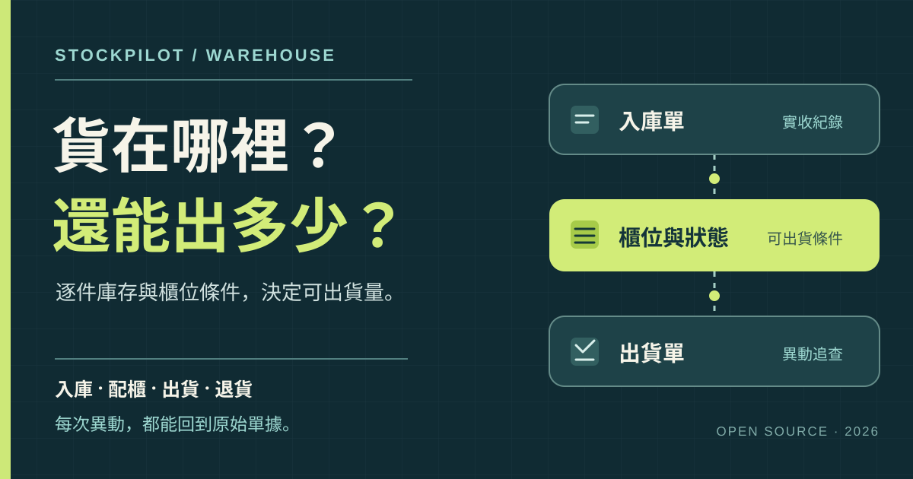

# StockPilot 倉管系統

**貨在哪裡、還能出多少、庫存為什麼變動，都應該查得到。**

StockPilot 倉管系統讓小型商家從 Excel 走向有單據可追的日常倉管流程：

- **庫存看得清楚：** 記錄商品、逐件庫存與櫃位，區分實體在庫和可出貨量。
- **進出有據可查：** 入庫、調撥、出貨與退貨各有紀錄，可沿商品與單據追查異動。
- **出貨由倉管掌握：** 直接建立出貨單，也能管理商品採購、物料與工廠生產紀錄。
- **AI 自然語言查詢：** 用日常用語詢問系統操作、庫存與出貨資料；目前只查詢已串接的資料，不會替你修改紀錄。

我曾參與規劃一套出貨流程，供年營收逾新台幣 1 億元的電商業務使用，並根據現場作業持續檢驗與修正。

StockPilot 倉管系統將這些實務經驗整理成開源專案，串起入庫、配櫃與出退貨。專案仍在驗收中，與我過去任職公司的系統分開開發。

[第一次操作](#第一次操作從這裡開始) · [功能與操作](#功能與操作) · [已知問題](#已知問題與使用提醒) · [操作指南](#操作指南) · [開發路線圖](ROADMAP.md)

> **專案狀態：開發與驗收中。** 目前以本機單人使用為主；核心頁面已有實作，完整瀏覽器操作驗收、帳號權限與備份還原仍待完成。不建議直接用於正式營運。

## 為什麼做這個專案

用試算表管理庫存時，總量往往看得見，能否出貨卻不清楚。即使某個 SKU 顯示有 10 件，其中也可能有幾件尚未配櫃、品質待確認，或已被其他出貨單預留。分批到貨、調撥和退貨後，若沒有對應單據，也很難追查庫存變動的原因。

StockPilot 倉管系統把商品、逐件庫存、入庫單、櫃位與出貨單串在一起。倉管人員能核對實體件數、存放位置與可出貨量，沿商品或單號追查每次異動，也能在系統內建立出貨單。

## 已知問題與使用提醒

- **出貨流程仍待完整驗收：** 本專案尚未完成真實瀏覽器中的配貨、揀貨與出貨全流程驗收，請先用測試資料試跑。
- **配貨需要可出貨櫃位：** 若沒有已啟用、符合商品條件且允許出貨的櫃位，配貨會失敗。
- **尚未驗證大量訂單情境：** 目前的本機配置尚未針對大量出貨單或多人同時使用驗證。若有這類需求，需先評估效能並調整部署；也歡迎[聯絡我](#聯絡我)討論合作。
- **目前以本機單人使用為主：** 尚無帳號權限或自動備份；資料儲存在本機 `.local/workspace.sqlite3`，不會隨 GitHub 儲存庫備份。

## 第一次操作，從這裡開始

1. 在「SKU 商品庫」建立一個測試商品，填入名稱與不重複的 SKU。
2. 在「入庫管理」建立並確認入庫單，再到「庫存總覽」核對件數。
3. 需要試出貨時，先在「櫃位管理」建立允許出貨的櫃位並完成配櫃，接著到「出貨管理」建立倉管自己的出貨單。完整步驟與常見卡點見[庫存與出貨指南](docs/inventory-shipping.md)。

建議先用自己建立的測試資料熟悉流程。目前仍在進行完整瀏覽器出貨驗收；遇到配貨失敗時，先依指南核對櫃位、品質、包裝與占用狀態。

## 功能與操作

| 功能 | 目前可做的事 |
| --- | --- |
| 商品與庫存 | 建立 SKU、條碼及商品屬性；查詢逐件庫存、品質與異動紀錄 |
| 入庫與櫃位 | 建立及確認入庫單、配櫃、管理櫃位與調撥 |
| 出貨作業 | 直接建立出貨單、加入商品、配貨、完成出貨與記錄退貨 |
| 出貨總覽 | 依實際出退貨事件查看數量、單據與成本口徑 |
| 採購與物料 | 商品叫貨與分批收貨、物料採購、生產單與實際用料紀錄 |
| AI 助理 | 用自然語言詢問系統操作與已支援的唯讀資料查詢 |

一個倉管流程是：建立 SKU → 採購或入庫 → 配置符合條件的櫃位 → 自行建立出貨單 → 配貨並完成出貨 → 必要時處理退貨。**入庫件數不等於可出貨件數**；櫃位、品質、包裝和占用狀態都會影響可用量。

## 操作指南

- [庫存與出貨指南](docs/inventory-shipping.md)：從商品入庫、配櫃到手動建立出貨單。
- [商品採購指南](docs/goods-purchases.md)：現成商品叫貨、分批收貨與入庫。
- [工廠生產指南](docs/production-workflow.md)：物料採購、工廠回報、實際用料與成品實收。

## 資料範圍

倉管系統使用本專案自己的本機 SQLite 資料庫。它不讀取營運系統的訂單，也不與營運系統交換資料；出貨單號由倉管端自行建立。儲存庫不包含營運資料或資料庫，程式碼上傳 GitHub 也不等於資料已備份。

## 授權

本專案採用 [MIT License](LICENSE)。第三方 ECharts 的授權與 NOTICE 位於 `web/vendor/echarts-6.1.0/`。

## 聯絡我

我是 [Ed Chen](https://github.com/EdChen0321)。如果你遇到操作問題，或需要擴充資料量、調整倉管流程，歡迎到本專案的 [GitHub Issues](https://github.com/EdChen0321/StockPilot-Warehouse/issues) 留言討論合作。公開留言請勿附上真實客戶、訂單或其他個資。
